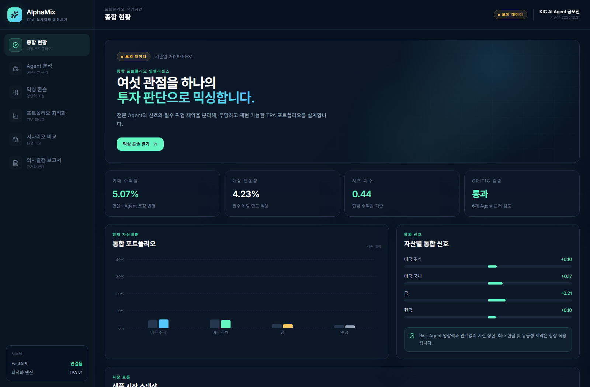
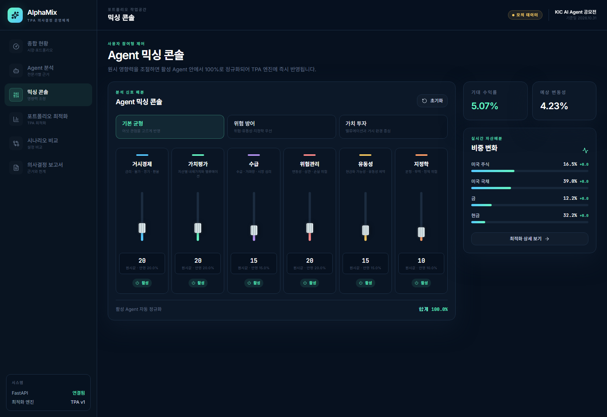
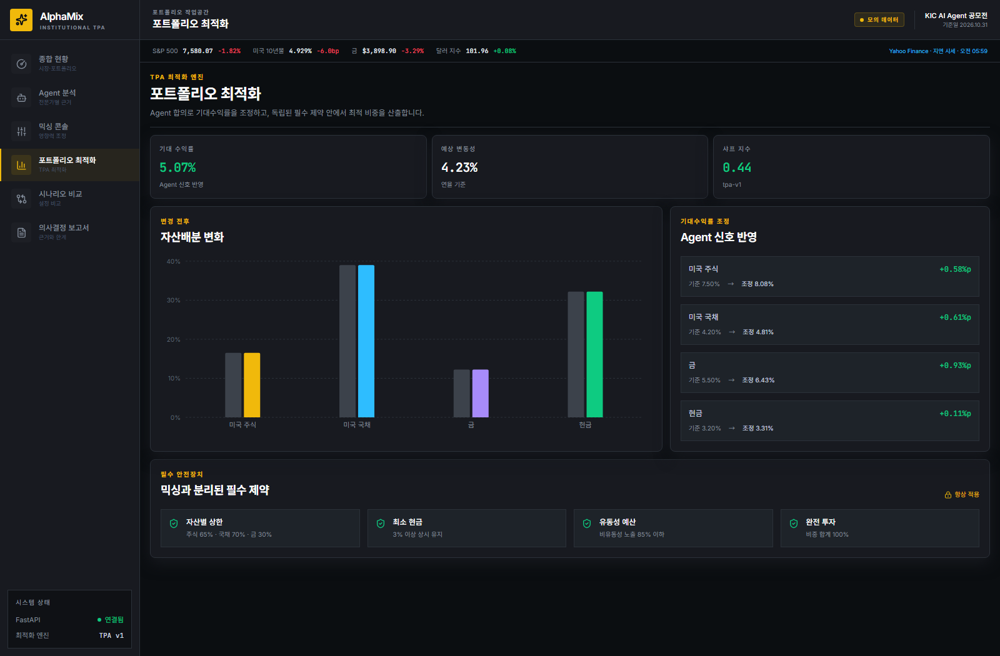
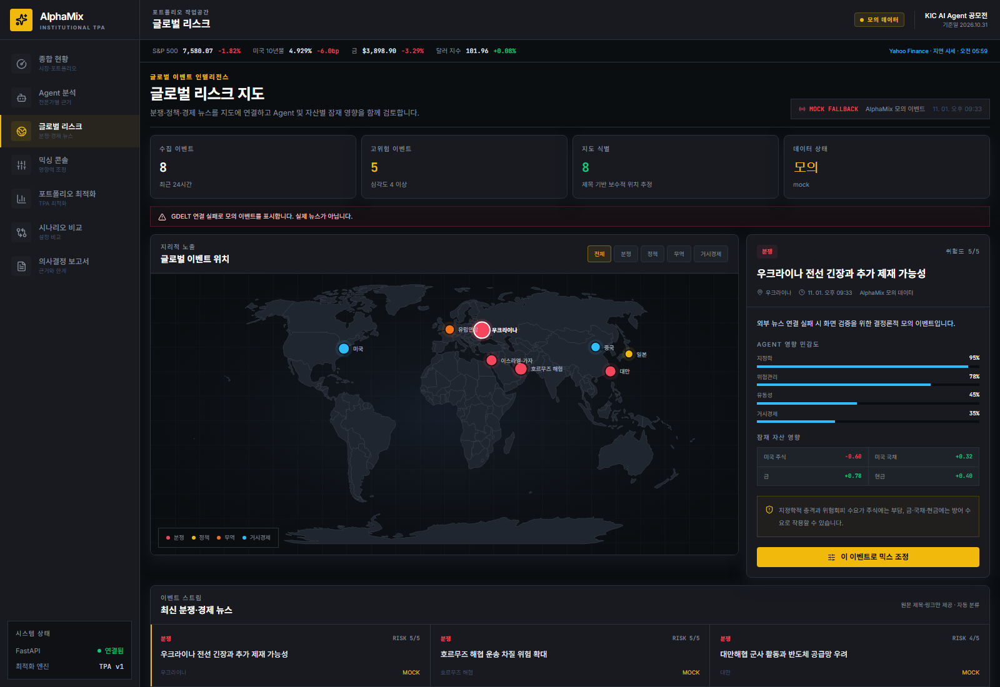

# AlphaMix

KIC AI Agent 공모전을 위한 **멀티 Agent TPA 포트폴리오 의사결정 플랫폼**입니다.

AlphaMix는 여섯 전문 Agent의 시장 관점을 오디오 믹싱 콘솔처럼 조합하고,
정규화된 신호를 제약 조건이 적용된 TPA(Total Portfolio Approach) 최적화
엔진에 전달합니다. MVP는 미국 주식, 미국 국채, 금, 현금을 지원하며 API 키
없이 재현 가능한 모의 데이터로 실행할 수 있습니다.

## 빠른 시작

기본 설정은 결정론적 Mock Agent를 사용하므로 API 키가 필요하지 않습니다.

### 백엔드

```powershell
cd backend
python -m pip install -e ".[dev]"
python -m uvicorn app.main:app --reload --port 8000
```

FastAPI 문서는 `http://localhost:8000/docs`에서 확인할 수 있습니다.

### 프론트엔드

두 번째 터미널에서 실행합니다.

```powershell
cd frontend
npm install
npm run dev
```

브라우저에서 `http://localhost:5173`을 엽니다. 프론트엔드는 기본적으로
`http://localhost:8000/api/v1`에 연결하며, 필요하면
`VITE_API_BASE_URL` 환경변수로 변경할 수 있습니다.

## 주요 기능

- 거시경제, 가치평가, 수급, 위험관리, 유동성, 지정학 Agent 분석
- Critic Agent의 출처·기준시점·점수 범위·한계 검증
- 6개 세로형 페이더, Agent 활성화/비활성화 및 자동 100% 정규화
- 페이더·숫자 입력·± 버튼을 결합한 기관 운용 터미널형 믹싱 UI
- 원시 가중치와 최종 정규화 반영률의 분리 표시, 실시간 결과 고정 패널
- Yahoo Finance 기반 S&P 500·미국 10년물·금·달러지수 지연 시세 티커
- GDELT 글로벌 뉴스와 코드 기반 세계 지도를 결합한 분쟁·정책·무역·거시경제 리스크 화면
- 지도 이벤트의 Agent 민감도·자산 영향 확인 및 믹싱 콘솔 반영
- 기본 균형, 위험 방어, 가치 투자 프리셋
- CVXPY 기반 TPA 최적화와 독립된 필수 위험·유동성 제약
- 변경 전후 포트폴리오 및 시나리오 비교
- SQLite 시나리오 저장과 통합 의사결정 보고서
- Mock/LLM 데이터 구분 및 환경변수 기반 모델 연동

## 화면 예시

### 종합 현황



### Agent 믹싱 콘솔



### 포트폴리오 최적화



### 글로벌 리스크 지도



## 검증

```powershell
cd backend
python -m pytest

cd ../frontend
npm test
npm run build
```

통합 MVP는 백엔드 테스트 23개와 프론트엔드 테스트 8개를 통과했습니다.
HTTP 스모크 테스트는 Agent 믹스 변경에 따라 최적 배분이 달라지는지,
전 가중치 0 입력이 거부되는지, 시나리오가 SQLite에 저장되는지를 검증합니다.

## 문서

- [시스템 아키텍처](docs/architecture.md)
- [API 계약](docs/api-contract.md)
- [개발 계획 및 테스트 기록](docs/development-plan.md)
- [비즈니스 시나리오](docs/business-scenarios.md)
- [검증 보고서](docs/validation-report.md)

## 선택적 LLM 모드

`.env.example`을 `backend/.env`로 복사하고 분석 API에서 `mode=llm`을
선택한 다음 `ALPHAMIX_LLM_API_URL`, `ALPHAMIX_LLM_MODEL`,
`ALPHAMIX_LLM_API_KEY`를 설정합니다. Mock과 LLM 분석은 동일한 검증
스키마를 사용하며, LLM 설명은 한국어로 요청됩니다.

> AlphaMix는 공모전용 의사결정 지원 프로토타입입니다. 샘플 가정은 설명을
> 위한 것이며 투자 권유로 해석해서는 안 됩니다.

시장 티커는 Yahoo Finance의 지연 시세를 60초 캐시해 표시합니다. Yahoo 연결
실패 시 화면에 fallback 상태를 명확히 알리며, 해당 데이터는 연구·교육용 로컬
데모 범위에서만 사용합니다. 공개·상업 서비스에는 정식 라이선스 공급자가
필요합니다.

글로벌 리스크 화면은 GDELT DOC 2.0의 공개 기사 메타데이터를 15분 캐시해
표시합니다. 제목 키워드 기반 분류·위치·영향 추정은 참고 신호이며, 연결 제한이나
응답 오류가 발생하면 실제 뉴스와 구분되는 `MOCK` 이벤트로 전환합니다.
